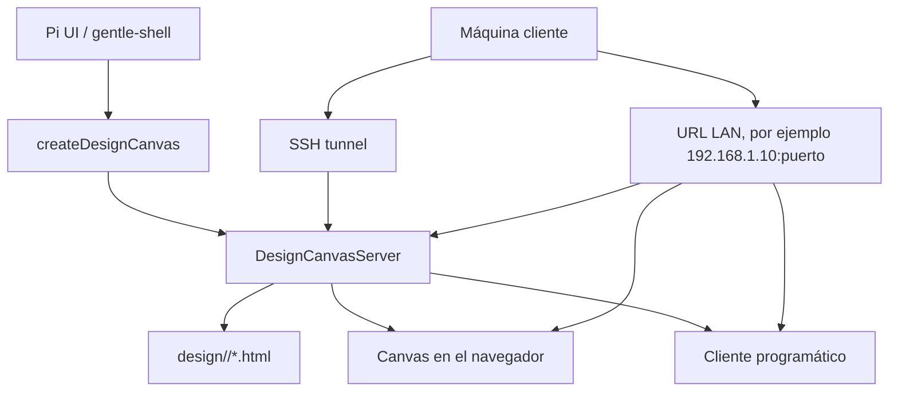
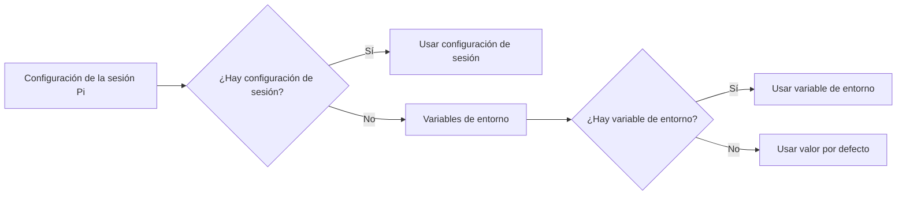
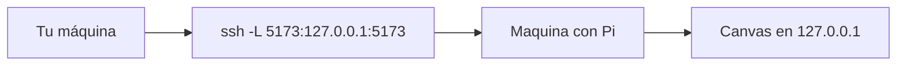
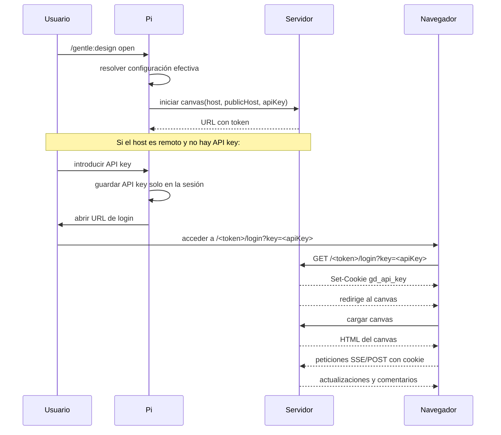
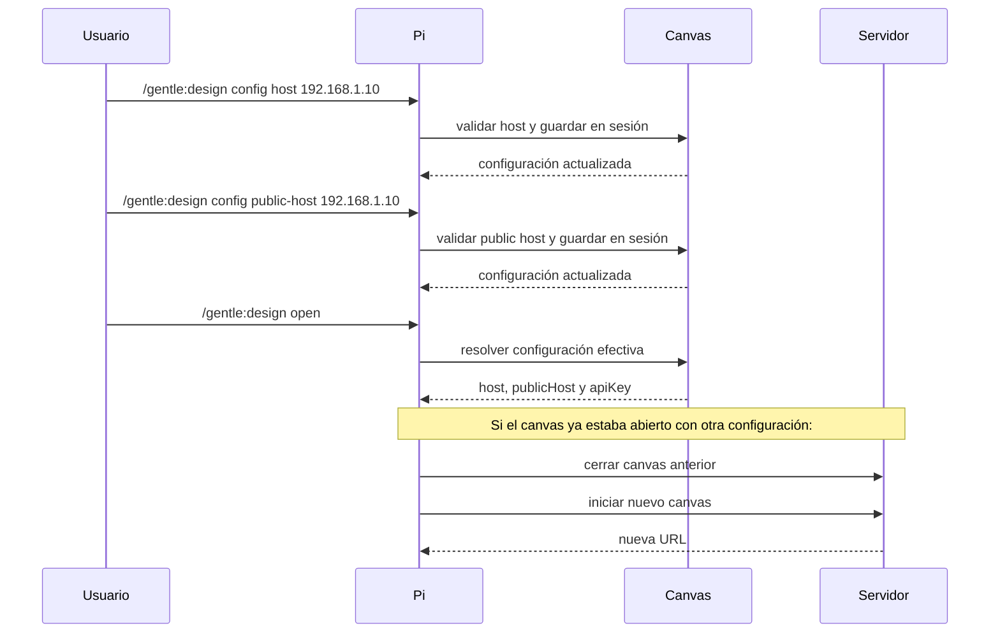
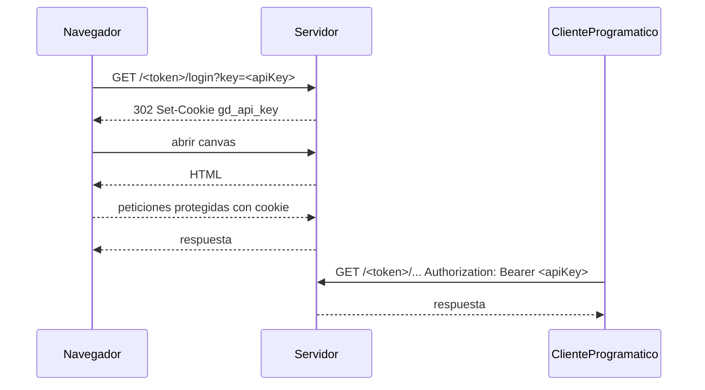
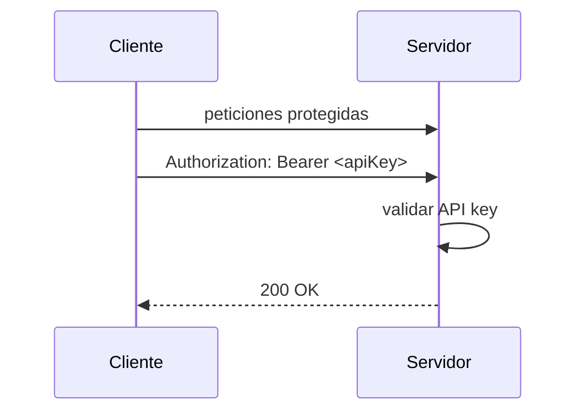

# Configuración del canvas de diseño remoto

Este documento explica en español las funcionalidades añadidas a `gentle-design` para acceder al canvas de diseño desde otra máquina, manteniendo el comportamiento local por defecto y añadiendo autenticación opcional para usos remotos.

## Objetivo

El canvas de `gentle-design` se ejecuta como un servidor web local dentro de la sesión de Pi. Antes, su comportamiento seguro era:

- escuchar solo en `127.0.0.1`;
- usar un puerto aleatorio;
- proteger cada ruta con un token aleatorio por servidor;
- no exponer el canvas a la red por defecto.

Con las nuevas funcionalidades, ahora es posible:

- configurar el host donde escucha el canvas;
- configurar el host público que aparece en las URL, los `Origin` permitidos y la CSP;
- proteger el acceso remoto con una API key;
- iniciar el navegador desde otra máquina mediante una URL de login;
- permitir acceso programático con `Authorization: Bearer`;
- conservar la API key solo durante la sesión Pi actual;
- reiniciar el canvas cuando cambia la configuración efectiva;
- seguir usando SSH tunnel como opción recomendada para acceso remoto sin exponer el servicio.

## Resumen de las funcionalidades

| Funcionalidad | Descripción |
|---|---|
| Canvas local por defecto | Si no hay configuración, el canvas sigue escuchando en `127.0.0.1`. |
| Host de escucha configurable | Se puede configurar con `GENTLE_DESIGN_HOST` o `/gentle:design config host <host>`. |
| Host público configurable | Se puede configurar con `GENTLE_DESIGN_PUBLIC_HOST` o `/gentle:design config public-host <host>`. |
| API key opcional | Se puede configurar con `GENTLE_DESIGN_API_KEY` o `/gentle:design config key`. |
| Login para navegador | La URL `/<token>/login?key=<apiKey>` establece una cookie `gd_api_key` y redirige al canvas. |
| Acceso programático | Los clientes externos pueden usar `Authorization: Bearer <apiKey>`. |
| Configuración de sesión | La configuración introducida desde Pi UI se mantiene solo en la sesión actual y no se escribe en un archivo persistente. |
| Reutilización de la API key | Cuando se abre un canvas remoto, Pi pide la API key solo una vez y la recuerda para el resto de la sesión. |
| Reinicio por configuración | Si cambia la configuración efectiva, el canvas en marcha se cierra y se reinicia con la nueva configuración. |
| Validación de hosts | El host de escucha y el host público se validan con las mismas reglas del servidor del canvas. |
| Seguridad conservada | Se mantiene el token por servidor, la validación de `Host`, la validación de `Origin` para peticiones POST y el control de rutas protegidas. |

## Arquitectura



El servidor del canvas sigue siendo la fuente de verdad para servir los archivos de diseño, los comentarios, la actualización en vivo y la autenticación. La configuración solo determina dónde escucha el servidor, qué host aparece en las URL y si se requiere una API key.

## Resolución de la configuración

La configuración efectiva se resuelve en este orden:



Por defecto:

| Campo | Valor por defecto |
|---|---|
| Host de escucha | `127.0.0.1` |
| Host público | igual que el host de escucha, salvo casos especiales |
| API key | no configurada |

Ejemplo de resolución:

```text
/gentle:design config host 192.168.1.10
```

Eso tiene prioridad sobre:

```bash
GENTLE_DESIGN_HOST=10.0.0.5
```

Y ambos tienen prioridad sobre el valor por defecto:

```text
127.0.0.1
```

## Configuración del servidor

### Opción 1: variables de entorno

Para exponer el canvas en una red local:

```bash
export GENTLE_DESIGN_HOST=192.168.1.10
export GENTLE_DESIGN_PUBLIC_HOST=192.168.1.10
export GENTLE_DESIGN_API_KEY=secreto-7382
```

Donde:

- `GENTLE_DESIGN_HOST` es la dirección donde Node escucha.
- `GENTLE_DESIGN_PUBLIC_HOST` es el host que aparece en las URL, las cabeceras permitidas y la CSP.
- `GENTLE_DESIGN_API_KEY` es la clave requerida para acceder al canvas cuando el host de escucha no es loopback.

Ejemplo con todas las interfaces:

```bash
export GENTLE_DESIGN_HOST=0.0.0.0
export GENTLE_DESIGN_PUBLIC_HOST=tu-dominio.example
export GENTLE_DESIGN_API_KEY=secreto-7382
```

Ejemplo detrás de un proxy inverso, si el canvas se sirve bajo otro nombre público:

```bash
export GENTLE_DESIGN_HOST=127.0.0.1
export GENTLE_DESIGN_PUBLIC_HOST=diseño.tu-dominio.example
export GENTLE_DESIGN_API_KEY=secreto-7382
```

En este último caso, el proxy debe encaminar la solicitud al servidor local y el navegador se conectará usando `http://diseño.tu-dominio.example`.

### Opción 2: desde la Pi UI

La configuración también puede definirse desde Pi:

```text
/gentle:design config show
/gentle:design config host 192.168.1.10
/gentle:design config public-host 192.168.1.10
/gentle:design config key
```

Cuando se ejecuta:

```text
/gentle:design config key
```

Pi pide la API key por la interfaz. La clave se guarda solo en la sesión Pi actual.

También se puede proporcionar una clave explícita:

```text
/gentle:design config key secreto-7382
```

Para mostrar la configuración efectiva:

```text
/gentle:design config show
```

Ejemplo de salida:

```text
Canvas bind host: 192.168.1.10 (session)
Canvas public host: 192.168.1.10 (session)
API key: ...382 (session)
```

La API key siempre se muestra enmascarada en la salida de `config show`.

Para borrar la configuración de sesión:

```text
/gentle:design config reset
```

Tras `reset`, el canvas vuelve a usar las variables de entorno, si existen, o los valores por defecto.

## Configuración del cliente

El cliente puede ser un navegador o un programa externo.

### Cliente navegador

Cuando el canvas está configurado para acceso remoto, el navegador debe iniciar sesión usando la URL de login.

Ejemplo:

```text
http://192.168.1.10:5173/<token>/login?key=secreto-7382
```

Donde:

- `192.168.1.10` es el host público del canvas;
- `5173` es el puerto asignado por el servidor;
- `<token>` es el token aleatorio generado para esa instancia del canvas;
- `secreto-7382` es la API key configurada.

Una vez que el navegador abre la URL de login, el servidor establece una cookie:

```http
Set-Cookie: gd_api_key=secreto-7382; HttpOnly; SameSite=Strict; Path=/
```

Después, el navegador puede abrir el canvas normal:

```text
http://192.168.1.10:5173/<token>/d/<slug>/
```

Ejemplo:

```text
http://192.168.1.10:5173/a1b2c3/d/login?key=secreto-7382
http://192.168.1.10:5173/a1b2c3/d/landing-landing-page/
```

La cookie permite que las peticiones posteriores del navegador, incluidas las actualizaciones en vivo y los comentarios, se autenticen sin volver a escribir la API key.

### Cliente programático

Un cliente programático puede usar la API key directamente en la cabecera `Authorization`:

```bash
curl -sS \
  -H "Authorization: Bearer secreto-7382" \
  "http://192.168.1.10:5173/<token>/"
```

Ejemplo genérico:

```bash
curl -sS \
  -H "Authorization: Bearer $GENTLE_DESIGN_API_KEY" \
  "http://$GENTLE_DESIGN_PUBLIC_HOST:$PUERTO/<token>/"
```

El acceso programático no necesita la cookie, pero debe enviar la API key en la cabecera:

```http
Authorization: Bearer <apiKey>
```

## Acceso remoto recomendado: SSH tunnel

La opción más segura para acceder desde otra máquina sigue siendo el túnel SSH, porque el canvas no se expone directamente en la red.

```bash
ssh -L 5173:127.0.0.1:5173 usuario@maquina-con-pi
```

Después, en tu máquina local, abres:

```text
http://localhost:5173
```

o la URL que te indique el canvas local.



En este modelo:

- el canvas sigue escuchando solo en `127.0.0.1` de la máquina remota;
- SSH crea un túnel local;
- el navegador local accede a `localhost`;
- no se expone el canvas en la red.

## Flujo de apertura remota desde Pi UI



## Flujo de configuración de sesión



## Flujo del navegador



## Flujo de cliente programático



## Comportamiento de la API key

La API key tiene este comportamiento:

1. Si el canvas escucha solo en loopback, por ejemplo `127.0.0.1`, no se requiere API key por defecto.
2. Si el canvas escucha fuera de loopback, por ejemplo `192.168.1.10`, se requiere API key.
3. Si el canvas escucha en una dirección wildcard, por ejemplo `0.0.0.0`, se requiere API key.
4. Si la API key viene de la configuración de sesión, se usa para abrir el canvas.
5. Si la API key viene de `GENTLE_DESIGN_API_KEY`, se usa cuando no hay configuración de sesión.
6. Si no hay API key disponible y el canvas remoto se abre desde la Pi UI, Pi pide la API key una sola vez.
7. La API key pedida se recuerda durante el resto de la sesión Pi.
8. No se vuelve a pedir la API key para:
   - correcciones;
   - actualizaciones;
   - reapertura del mismo canvas;
   - refresco del canvas abierto.
9. La API key no se escribe en un archivo de configuración persistente.

## Reinicio del canvas al cambiar la configuración

Si el canvas ya está abierto y cambia la configuración efectiva, el canvas anterior se cierra y se inicia una nueva instancia con la nueva configuración.

Ejemplo:

```text
/gentle:design open
/gentle:design config host 10.0.0.5
/gentle:design config public-host 10.0.0.5
/gentle:design open
```

En ese caso, el canvas anterior, iniciado en `127.0.0.1`, se detiene y se inicia un nuevo canvas en `10.0.0.5`.

Esto evita que una URL antigua siga usando un host, un host público o una API key desactualizados.

## Seguridad

Las reglas principales de seguridad son:

- El canvas por defecto no escucha en la red.
- Cada servidor tiene un token aleatorio por instancia.
- Las URL del canvas incluyen ese token.
- Las peticiones protegidas requieren autenticación.
- El navegador usa una cookie `HttpOnly` y `SameSite=Strict`.
- Los clientes programáticos usan `Authorization: Bearer`.
- El servidor valida `Host`, `Origin` y rutas permitidas.
- El API key se muestra enmascarado en la salida de `config show`.
- La API key no se persiste en disco desde la configuración de sesión.
- SSH tunnel sigue siendo la forma más segura de acceder desde otra máquina.

No se recomienda exponer el canvas sobre HTTP en una red no confiable. Si se necesita acceso remoto sin SSH, usar una API key fuerte, un proxy con TLS, firewall o una red privada confiable.

## Ejemplo completo

### Servidor

```bash
export GENTLE_DESIGN_HOST=192.168.1.10
export GENTLE_DESIGN_PUBLIC_HOST=192.168.1.10
export GENTLE_DESIGN_API_KEY=secreto-7382
```

### Pi UI

```text
/gentle:design config show
/gentle:design config host 192.168.1.10
/gentle:design config public-host 192.168.1.10
/gentle:design config key
```

Al ejecutar:

```text
/gentle:design open
```

Pi puede pedir la API key si no está disponible. Una vez introducida, se recuerda para el resto de la sesión.

### Cliente navegador

```text
http://192.168.1.10:5173/<token>/login?key=secreto-7382
http://192.168.1.10:5173/<token>/d/<slug>/
```

### Cliente programático

```bash
curl -sS \
  -H "Authorization: Bearer secreto-7382" \
  "http://192.168.1.10:5173/<token>/"
```

## Diferencia entre SSH tunnel y bind remoto

| Método | Seguridad | Complejidad | Uso recomendado |
|---|---:|---:|---|
| SSH tunnel | Alta | Baja | Acceso remoto desde otra máquina sin exponer el canvas |
| Bind LAN con API key | Media | Media | Acceso desde la red local con API key |
| Bind público con API key | Baja/media | Alta | Solo con TLS, firewall o red confiable |
| Canvas por defecto | Alta | Ninguna | Uso local normal |

## Notas

- La configuración de sesión no crea archivos como `gentle-design-config.json`.
- `config reset` borra la configuración de sesión, no los archivos de diseño.
- La API key no se expone completa en la salida de `config show`.
- El canvas reinicia automáticamente cuando cambia la configuración efectiva.
- El token del canvas sigue siendo único por servidor.
- El login del navegador establece una cookie local para el navegador que accede al canvas.
- El acceso programático puede usar `Authorization: Bearer` directamente.
